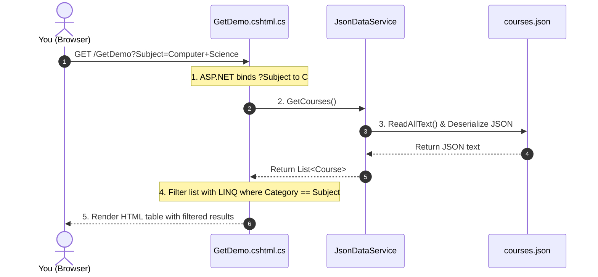
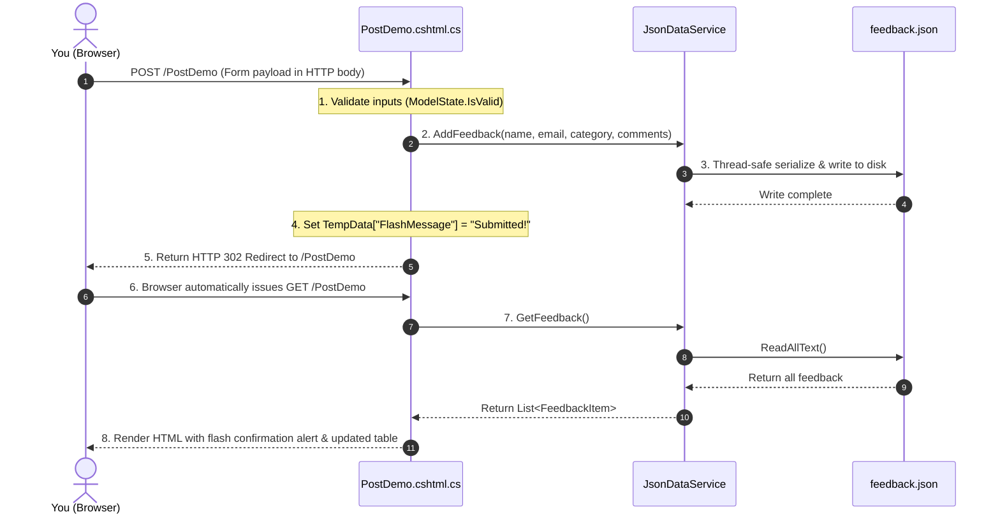

# Student Guide: How the Data Works (JSON & Services)

Welcome to the data architecture guide! When you build web applications, you need a reliable way to store and retrieve data. In this guide, you will learn how this application manages data using clean, local **JSON files** and a **Dependency-Injected C# Service**, without requiring a complex SQL database setup.

---

## 1. Why We Use JSON for This Lab

When learning web development, configuring relational database servers, connection strings, user credentials, and database migrations can sometimes get in the way of what you are really trying to master: **understanding the HTTP protocol, URL routing, and web forms**.

For this lab, we use simple JSON files in the `Data/` directory for four practical reasons:

1. **Zero Database Setup**:
   You don't need to install SQL Server, configure Docker containers, or run migrations (`dotnet ef database update`). The project works right out of the box with `dotnet run`.
2. **Transparent, Inspectable Data**:
   You can open any file in the `Data/` folder right inside VS Code or Visual Studio. You can inspect the raw text, add mock records, or watch new entries appear when you submit a form.
3. **No External Packages Needed**:
   By using .NET's built-in `System.Text.Json` library, our project has zero third-party database dependencies. This keeps your project fast, clean, and lightweight.
4. **Git-Friendly & Easy to Reset**:
   If you ever want to reset your demo data back to the starting point, you can simply run `git checkout Data/`.

---

## 2. Tour of Your Data Files

All data files live in the `Data/` folder:

```
Data/
├── courses.json     # Course catalog queried by Demo 1 (GET)
├── staff.json       # Employee entity records used by Demos 2 & 3 (Routing)
└── feedback.json    # Submissions written by Demo 4 (POST)
```

### `Data/courses.json` (Read-Only Dataset)
* **Used by**: **Demo 1 (`/GetDemo`)**
* **Purpose**: Simulates an academic course catalog.
* **How it helps you learn**: When you select dropdown filters on the GET demo page, your C# code reads this list and filters it using LINQ based on the query string parameters you provided.

```json
[
  {
    "code": "CS101",
    "title": "Web Development Fundamentals",
    "category": "Computer Science",
    "level": "Beginner"
  },
  {
    "code": "CS102",
    "title": "ASP.NET Core Razor Pages",
    "category": "Computer Science",
    "level": "Intermediate"
  }
]
```

### `Data/staff.json` (Structured Entity Dataset)
* **Used by**: **Demo 2 (`/RouteDemo`)** and **Demo 3 (`/MultiRouteDemo`)**
* **Purpose**: Simulates an employee directory grouped by departments (`engineering`, `design`, `product`).
* **How it helps you learn**:
  * In Demo 2, route parameter `{id}` selects a specific employee from this file.
  * In Demo 3, route parameter `{department}` filters staff members belonging to that department slug.

```json
[
  {
    "id": 101,
    "name": "Alice Morgan",
    "role": "Lead Software Engineer",
    "department": "engineering",
    "email": "alice@example.com",
    "salary": "£75,000",
    "employmentType": "Full-Time",
    "hiredDate": "2019-03-15"
  }
]
```

### `Data/feedback.json` (Read & Write Dataset)
* **Used by**: **Demo 4 (`/PostDemo`)**
* **Purpose**: Stores student feedback submissions.
* **How it helps you learn**: When you submit the POST form, your server creates a new C# object, serializes it to JSON, and appends it to this file. When the page redirects via GET, it reads this file to display your submission in the table below.

```json
[
  {
    "Id": 1,
    "StudentName": "Alex Taylor",
    "Email": "alex@university.ac.uk",
    "Category": "Lab Exercise",
    "Comments": "Great demonstration of HTTP POST and the PRG pattern!",
    "SubmittedAt": "2026-10-19T08:30:00"
  }
]
```

---

## 3. Mapping JSON to C# Models (Records)

To work with JSON in C# with type safety, we define C# models in the `Models/` folder. We use modern C# `record` types because they provide concise syntax, automatic immutability, and built-in equality comparison.

* **[Course.cs](Models/Course.cs)**:
  ```csharp
  namespace MyRazorApp.Models;

  public record Course(
      string Code,
      string Title,
      string Category,
      string Level
  );
  ```
* **[StaffMember.cs](Models/StaffMember.cs)**:
  ```csharp
  namespace MyRazorApp.Models;

  public record StaffMember(
      int Id,
      string Name,
      string Role,
      string Department,
      string Email,
      string Salary,
      string EmploymentType,
      string HiredDate
  );
  ```
* **[FeedbackItem.cs](Models/FeedbackItem.cs)**:
  ```csharp
  namespace MyRazorApp.Models;

  public record FeedbackItem(
      int Id,
      string StudentName,
      string Email,
      string Category,
      string Comments,
      DateTime SubmittedAt
  );
  ```

---

## 4. The Service Pattern: Meet `JsonDataService`

A common beginner mistake is to write `File.ReadAllText()` or database queries directly inside Razor Page event handlers (`OnGet` / `OnPost`).

Instead, professional software design follows the **Separation of Concerns** principle:
* **Razor Pages (`.cshtml` & `.cshtml.cs`)**: Responsible *only* for handling HTTP requests, input validation, and rendering UI.
* **Service Layer (`JsonDataService.cs`)**: Responsible *only* for reading, writing, and parsing data.

Let's examine how `Services/JsonDataService.cs` works:

### A. Finding Files Safely with `IWebHostEnvironment`
Never hardcode file paths like `C:\Users\...\Data\staff.json`! Hardcoded paths break when your app runs on a friend's computer, on a Mac, or on a Linux server.

Instead, we inject `IWebHostEnvironment` to find the project root dynamically:
```csharp
public JsonDataService(IWebHostEnvironment env)
{
    var dataDir = Path.Combine(env.ContentRootPath, "Data");
    _staffFilePath = Path.Combine(dataDir, "staff.json");
    _coursesFilePath = Path.Combine(dataDir, "courses.json");
    _feedbackFilePath = Path.Combine(dataDir, "feedback.json");
}
```

### B. Deserializing JSON into C# Objects
We use .NET's built-in `System.Text.Json.JsonSerializer`:
```csharp
private readonly JsonSerializerOptions _jsonOptions = new()
{
    PropertyNameCaseInsensitive = true, // Matches "name" in JSON to "Name" in C#
    WriteIndented = true                // Formats output with clean indents
};

public List<Course> GetCourses()
{
    if (!File.Exists(_coursesFilePath)) return [];
    var json = File.ReadAllText(_coursesFilePath);
    return JsonSerializer.Deserialize<List<Course>>(json, _jsonOptions) ?? [];
}
```

### C. Safe Writes with Thread Locking
Imagine two students submit feedback at the exact same millisecond. If both try to write to `Data/feedback.json` at the same time, the file could become corrupted.

To prevent this, `JsonDataService` uses a C# `lock`:
```csharp
private readonly object _feedbackLock = new();

public void AddFeedback(string studentName, string email, string category, string comments)
{
    lock (_feedbackLock)
    {
        var list = GetFeedback();
        int nextId = list.Count > 0 ? list.Max(f => f.Id) + 1 : 1;
        var item = new FeedbackItem(nextId, studentName, email, category, comments, DateTime.Now);
        list.Insert(0, item); // Put newest at the top
        var json = JsonSerializer.Serialize(list, _jsonOptions);
        File.WriteAllText(_feedbackFilePath, json);
    }
}
```
Only one request at a time is allowed inside the `lock` block, ensuring your data is always written cleanly.

---

## 5. Dependency Injection: How Pages Get the Service

How do your Razor Pages access `JsonDataService`? In ASP.NET Core, we use **Dependency Injection (DI)**.

### Step 1: Register in `Program.cs`
At application startup, we register `JsonDataService` with the service container:
```csharp
var builder = WebApplication.CreateBuilder(args);

builder.Services.AddRazorPages();
builder.Services.AddSingleton<JsonDataService>(); // Registered here!
```
By registering it as a **Singleton**, ASP.NET Core creates a single shared instance of `JsonDataService` that lives as long as the web app is running.

### Step 2: Inject into PageModels via Constructor
When a page needs data, it simply asks for `JsonDataService` in its constructor:
```csharp
public class RouteDemoModel : PageModel
{
    private readonly JsonDataService _jsonDataService;

    // ASP.NET Core automatically supplies the service here!
    public RouteDemoModel(JsonDataService jsonDataService)
    {
        _jsonDataService = jsonDataService;
    }

    public void OnGet(int? id)
    {
        // Now you can easily use the service:
        SampleStaff = _jsonDataService.GetStaff();
    }
}
```

---

## 6. End-to-End Tracing: What Happens During a Request?

Let's trace the complete lifecycle of both a read operation (GET) and a write operation (POST).

### A. The Read Lifecycle (HTTP GET `/GetDemo`)


### B. The Write & PRG Lifecycle (HTTP POST `/PostDemo`)


---

## 7. Key Takeaways for Your Coursework

1. **Practice LINQ**: Because `JsonDataService` returns standard C# collections (`List<Course>`, `List<StaffMember>`), you can practice using LINQ queries (`.Where(...)`, `.FirstOrDefault(...)`, `.Select(...)`) exactly the same way you will when working with databases like Entity Framework.
2. **Keep Pages Clean**: Keep your database/file logic out of `.cshtml.cs` files. Centralizing data operations in a dedicated Service class makes your code easier to read, test, and maintain.
3. **Use the PRG Pattern on Every Form**: Whenever you write an `OnPost()` method in Razor Pages, remember to end it with `return RedirectToPage(...)`. Your users (and your exam graders!) will thank you for preventing duplicate submissions.
