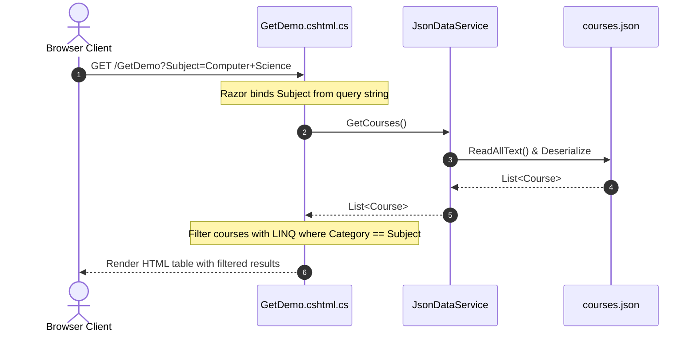
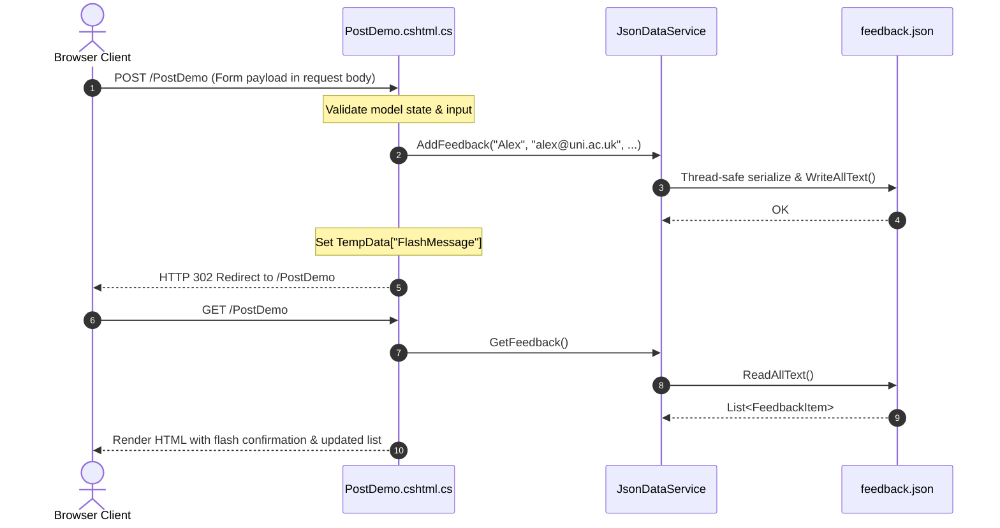

# How the Data Works: JSON Storage & Service Architecture

This document explains the data layer in this application, including why JSON files were chosen over a traditional relational database, how data is organized, and how the dependency-injected service manages reads and writes.

---

## 1. Why JSON Instead of a Traditional Database?

In early iterations of this demo suite, the application relied on SQLite and Entity Framework Core (`ApplicationDbContext`). For an educational application specifically focused on teaching **HTTP protocol semantics and URL routing**, replacing a SQL database with local JSON files provides several benefits:

1. **Zero Database Configuration**:
   Students do not need to install SQL Server, configure database connection strings, or run Entity Framework migrations (`dotnet ef database update`). The application clones and runs immediately with `dotnet run`.
2. **Transparent, Human-Readable Data**:
   Students can open the `Data/*.json` files directly in their code editor to see raw data records, modify them, or observe new entries being appended in real-time.
3. **No External Package Dependencies**:
   By relying on .NET's built-in `System.Text.Json` library, `Microsoft.EntityFrameworkCore.Sqlite` and its related dependencies are eliminated, keeping `MyRazorApp.csproj` lean and lightweight.
4. **Git-Friendly**:
   JSON files can be tracked, versioned, and diffed directly in version control.

---

## 2. The JSON Data Files

All application data resides in the `Data/` directory:

```
Data/
├── courses.json     # Course catalog for the GET filtering demo
├── staff.json       # Employee entity records for the Route parameter demos
└── feedback.json    # Persisted submissions from the POST demo
```

### `Data/courses.json` (Read-Only Dataset)
Contains an array of educational courses used in **Demo 1 (`/GetDemo`)** to illustrate query-string-based filtering:
```json
[
  {
    "code": "CS101",
    "title": "Web Development Fundamentals",
    "category": "Computer Science",
    "level": "Beginner"
  },
  ...
]
```

### `Data/staff.json` (Hierarchical Entity Dataset)
Contains staff members grouped by department (`engineering`, `design`, `product`). This data is consumed by:
* **Demo 2 (`/RouteDemo/{id}`)**: Resolves an employee by their unique integer `id`.
* **Demo 3 (`/MultiRouteDemo/{department}/{id}`)**: Resolves staff members filtered by the `department` path parameter.

```json
[
  {
    "id": 101,
    "name": "Alice Morgan",
    "role": "Lead Software Engineer",
    "department": "engineering",
    "email": "alice@example.com",
    "salary": "£75,000",
    "employmentType": "Full-Time",
    "hiredDate": "2019-03-15"
  },
  ...
]
```

### `Data/feedback.json` (Read/Write Persistent Dataset)
Stores user-submitted feedback entries. When a user submits the form in **Demo 4 (`/PostDemo`)**, the server creates a new entry and appends it to this file:
```json
[
  {
    "Id": 1,
    "StudentName": "Alex Taylor",
    "Email": "alex@university.ac.uk",
    "Category": "Lab Exercise",
    "Comments": "Great demonstration of HTTP POST and the PRG pattern!",
    "SubmittedAt": "2026-10-19T08:30:00"
  }
]
```

---

## 3. C# Data Models

The data structures in the JSON files map directly to C# `record` types in the `Models/` folder:

* **[Course.cs](Models/Course.cs)**:
  ```csharp
  namespace MyRazorApp.Models;

  public record Course(
      string Code,
      string Title,
      string Category,
      string Level
  );
  ```
* **[StaffMember.cs](Models/StaffMember.cs)**:
  ```csharp
  namespace MyRazorApp.Models;

  public record StaffMember(
      int Id,
      string Name,
      string Role,
      string Department,
      string Email,
      string Salary,
      string EmploymentType,
      string HiredDate
  );
  ```
* **[FeedbackItem.cs](Models/FeedbackItem.cs)**:
  ```csharp
  namespace MyRazorApp.Models;

  public record FeedbackItem(
      int Id,
      string StudentName,
      string Email,
      string Category,
      string Comments,
      DateTime SubmittedAt
  );
  ```

---

## 4. The Service Architecture (`JsonDataService`)

Rather than having individual Razor Pages read and write raw files directly, all file I/O operations are centralized inside **`Services/JsonDataService.cs`**.

### Resolving File Paths with `IWebHostEnvironment`
To ensure paths work reliably across different operating systems (macOS, Windows, Linux) and deployment directories, the service injects `IWebHostEnvironment` to resolve the root folder:

```csharp
public JsonDataService(IWebHostEnvironment env)
{
    var dataDir = Path.Combine(env.ContentRootPath, "Data");
    _staffFilePath = Path.Combine(dataDir, "staff.json");
    _coursesFilePath = Path.Combine(dataDir, "courses.json");
    _feedbackFilePath = Path.Combine(dataDir, "feedback.json");
}
```

### Reading and Deserialization
Files are read and parsed using `System.Text.Json.JsonSerializer`:

```csharp
private readonly JsonSerializerOptions _jsonOptions = new()
{
    PropertyNameCaseInsensitive = true,
    WriteIndented = true
};

public List<Course> GetCourses()
{
    if (!File.Exists(_coursesFilePath)) return [];
    var json = File.ReadAllText(_coursesFilePath);
    return JsonSerializer.Deserialize<List<Course>>(json, _jsonOptions) ?? [];
}
```

### Writing and Thread-Safety
When a POST request is submitted, multiple concurrent requests could attempt to write to `Data/feedback.json` simultaneously. To prevent file-access collisions, write operations use an internal lock:

```csharp
private readonly object _feedbackLock = new();

public void AddFeedback(string studentName, string email, string category, string comments)
{
    lock (_feedbackLock)
    {
        var list = GetFeedback();
        int nextId = list.Count > 0 ? list.Max(f => f.Id) + 1 : 1;
        var item = new FeedbackItem(nextId, studentName, email, category, comments, DateTime.Now);
        list.Insert(0, item);
        var json = JsonSerializer.Serialize(list, _jsonOptions);
        File.WriteAllText(_feedbackFilePath, json);
    }
}
```

---

## 5. Dependency Injection (DI)

### Registering the Service in `Program.cs`
In ASP.NET Core, services are registered into the built-in Inversion of Control (IoC) container during startup:

```csharp
var builder = WebApplication.CreateBuilder(args);

// Add services to the container.
builder.Services.AddRazorPages();
builder.Services.AddSingleton<JsonDataService>();
```

Registering `JsonDataService` as a **Singleton** ensures a single instance lives for the lifetime of the application, managing access to the data files and holding the file lock object.

### Injecting into Razor Page Models
Each Razor PageModel requests `JsonDataService` through its constructor:

```csharp
public class GetDemoModel : PageModel
{
    private readonly JsonDataService _jsonDataService;

    public GetDemoModel(JsonDataService jsonDataService)
    {
        _jsonDataService = jsonDataService;
    }

    public void OnGet()
    {
        var courses = _jsonDataService.GetCourses();
        // Filter courses with LINQ based on query string parameters...
    }
}
```

---

## 6. End-to-End Data Lifecycle Examples

### A. Reading with HTTP GET (`/GetDemo`)


### B. Mutating with HTTP POST & the PRG Pattern (`/PostDemo`)


---

## 7. Educational Takeaways for Students

1. **Separation of Concerns**: Razor Pages handle presentation, HTTP routing, and input validation; `JsonDataService` encapsulates data retrieval and serialization.
2. **Stateless Protocols vs Persistence**: HTTP is a stateless protocol. Using `JsonDataService` inside the Post-Redirect-Get pattern illustrates how state mutation is safely separated from state presentation.
3. **LINQ over Collections**: Because `JsonDataService` returns standard .NET collections (`List<Course>`, `List<StaffMember>`), students can practice using LINQ methods (`.Where()`, `.FirstOrDefault()`, `.Select()`, `.Distinct()`) identical to how they would query an Entity Framework `DbSet`.
